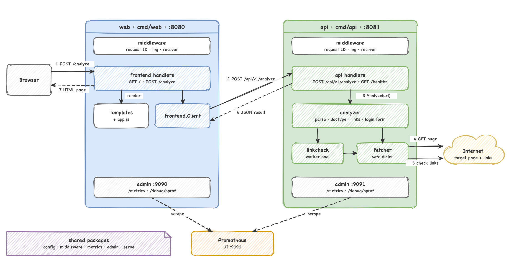

# Architecture

To change the diagram, open [architecture.drawio](architecture.drawio) in draw.io.

## Services

| Service | Entry point | Function |
|---------|-------------|----------|
| web     | `cmd/web`   | Shows the HTML pages. Sends requests to the api. |
| api     | `cmd/api`   | Gets a page and analyzes it. Returns JSON. |

Each service has an admin port for `/metrics` and `/debug/pprof`. Prometheus reads the metrics.

## Packages

| Package      | Function |
|--------------|----------|
| `frontend`   | Web routes, templates and the api client. |
| `api`        | API routes and the JSON error format. |
| `analyzer`   | Reads the HTML. Finds the version, title, headings, links and login form. |
| `fetcher`    | Gets the page. Blocks private addresses. |
| `linkcheck`  | Checks the links with a pool of workers. |
| `middleware` | Request ID, logs and panic recovery. |
| `metrics`    | Prometheus metrics. |
| `admin`      | The admin server. |
| `config`     | Reads settings from environment variables. |
| `serve`      | Starts the servers and stops them safely. |

## Request flow

1. The browser sends the URL to `POST /analyze` on web.
2. web sends the URL to `POST /api/v1/analyze` on api, with the same `X-Request-ID`.
3. The api handler calls the analyzer.
4. The fetcher gets the page.
5. The analyzer reads the HTML. The link checker checks the links.
6. api sends the result as JSON.
7. web shows the result as an HTML page.
