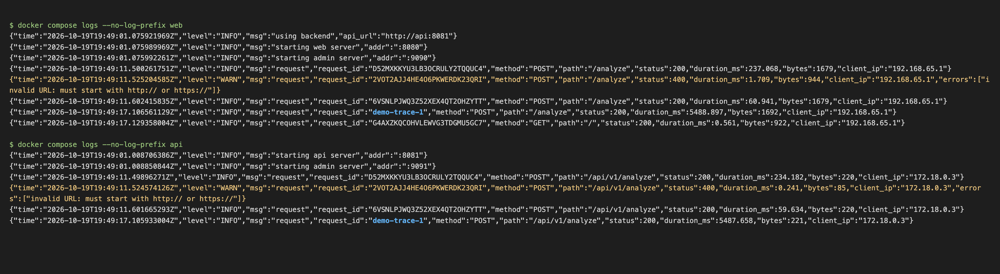
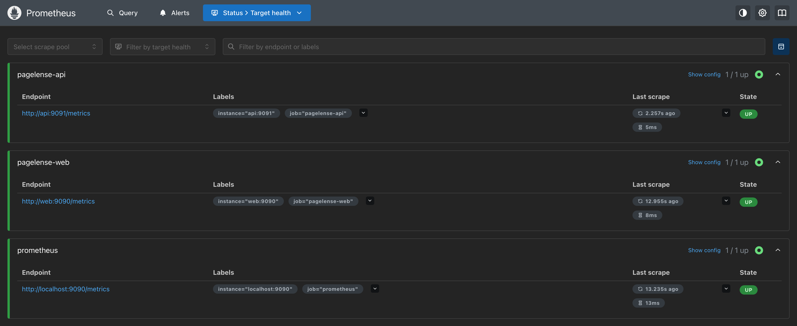
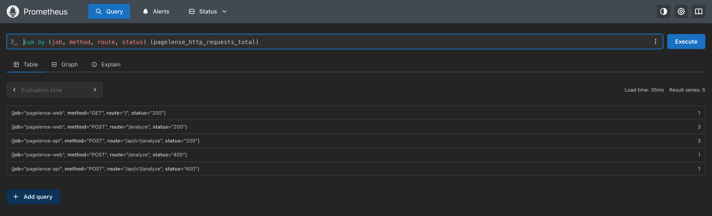
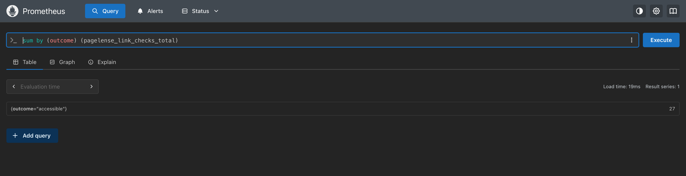

# Observability

Each service has an admin port with `/metrics` and `/debug/pprof`: 9091 for api, 9090 for web. compose keeps those ports on its own network and doesn't publish them. Prometheus runs at http://localhost:9090 and scrapes both services every 15 seconds (see [prometheus.yml](../infra/prometheus/prometheus.yml)).

## Logs

Each service writes one JSON line per request. The facebook.com request below was sent with `X-Request-ID: demo-trace-1`, and web passes that ID on to api, so the same request can be found in both logs. Requests that fail validation are logged at `WARN` with the cause in `errors`.

```sh
docker compose logs --no-log-prefix web api
```



## Metrics

All metric names start with `pagelense_`.

| Metric | Type | Labels | Service |
|--------|------|--------|---------|
| `http_requests_total` | counter | `method`, `route`, `status` | api, web |
| `http_request_duration_seconds` | histogram | `method`, `route` | api, web |
| `analysis_duration_seconds` | histogram | `outcome` (`ok`, `error`) | api |
| `link_checks_total` | counter | `outcome` (`accessible`, `inaccessible`, `failed`) | api |
| `backend_request_duration_seconds` | histogram | `outcome` (`ok`, `error`) | web |
| `backend_errors_total` | counter | `status` (502 unreachable, 504 timeout, or the api's own status) | web |

## Prometheus

Both services are up on the targets page:



Requests by service, route and status, after a few analyses (example.com twice, facebook.com, and one URL without a scheme) and a home page load. Each analysis on web makes one request to api, so the `POST` counts match:

```promql
sum by (job, method, route, status) (pagelense_http_requests_total)
```



Link check outcomes:

```promql
sum by (outcome) (pagelense_link_checks_total)
```


