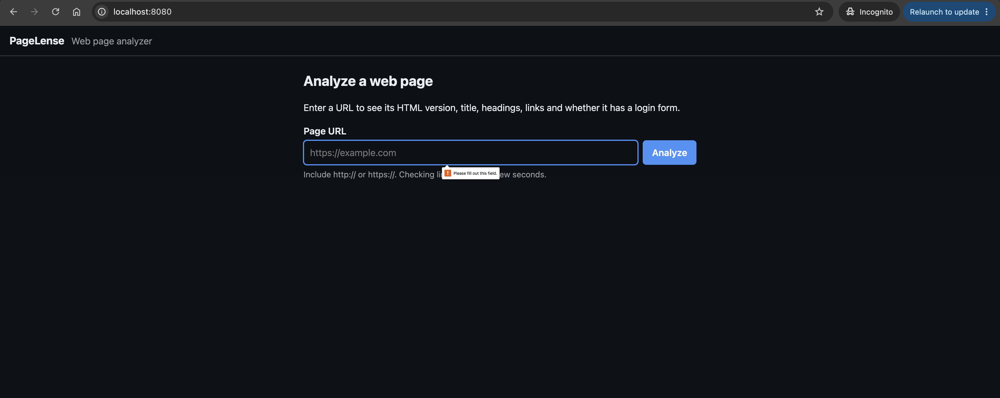
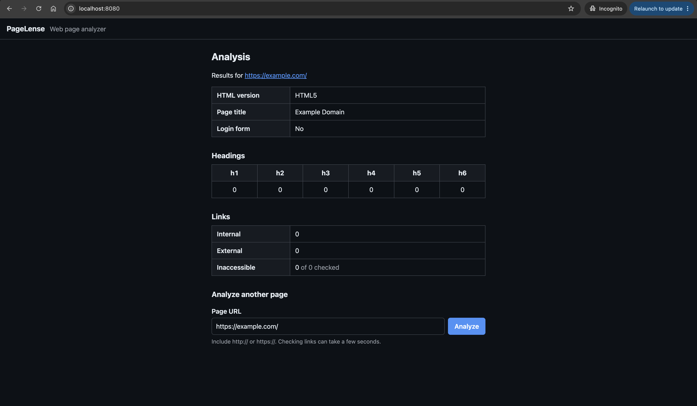
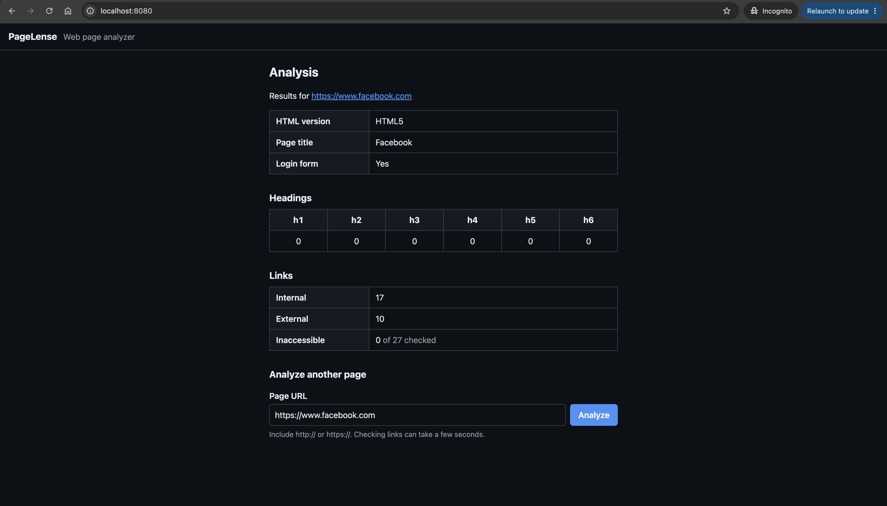
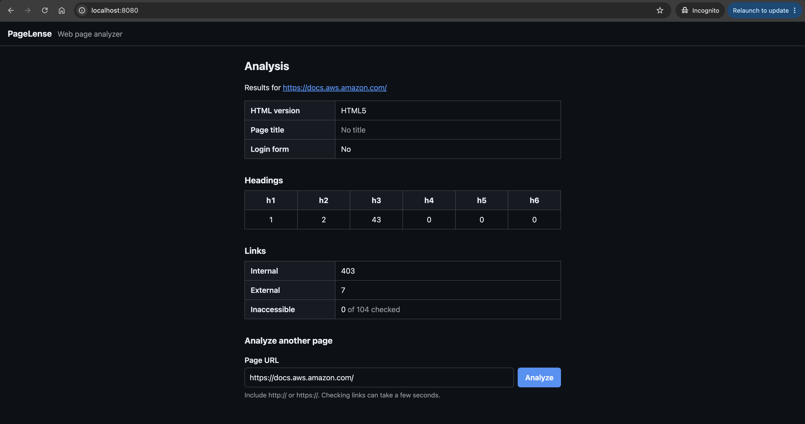
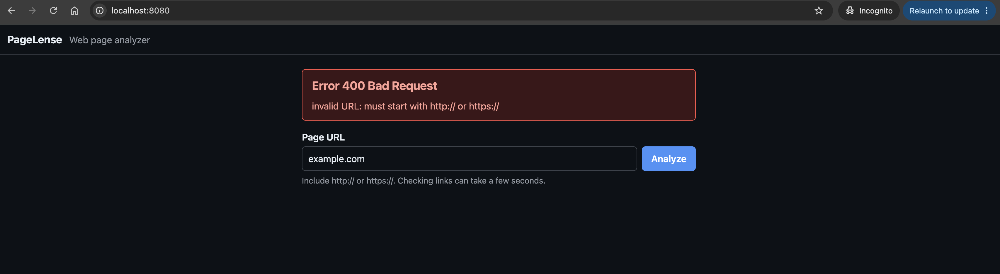
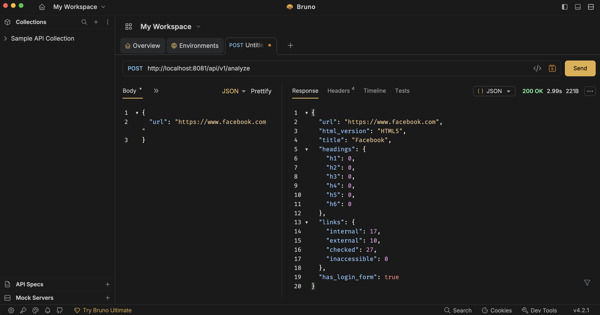

# Testing

All tests are plain `go test` with the standard library's `httptest`. Nothing reaches the internet: every page, API and slow host is a local test server.

```sh
make test    # go test -race ./...
make cover   # coverage report, fails under 70%
make lint    # golangci-lint
```

## Results

Run on 2026-10-19 with Go 1.27.2 (darwin/arm64).

### Tests

124 test functions and 242 subtests, all passing with `-race`.

| Package      | Tests | Subtests | Coverage |
|--------------|------:|---------:|---------:|
| `admin`      |     3 |        7 |   100.0% |
| `analyzer`   |    14 |       96 |    98.4% |
| `api`        |    15 |       18 |    97.1% |
| `config`     |    10 |       24 |   100.0% |
| `fetcher`    |    17 |       48 |   100.0% |
| `frontend`   |    36 |       21 |    93.2% |
| `linkcheck`  |    15 |       18 |    96.7% |
| `metrics`    |     5 |        4 |   100.0% |
| `middleware` |     5 |        6 |   100.0% |
| `serve`      |     4 |        0 |   100.0% |

`cmd/api` and `cmd/web` are only `main` functions that load config and call `serve.Run`, so they have no tests of their own.

### Coverage

```
$ make cover
ok  	github.com/SasangaME/pagelense/internal/admin	coverage: 100.0% of statements
ok  	github.com/SasangaME/pagelense/internal/analyzer	coverage: 98.4% of statements
ok  	github.com/SasangaME/pagelense/internal/api	coverage: 97.1% of statements
ok  	github.com/SasangaME/pagelense/internal/config	coverage: 100.0% of statements
ok  	github.com/SasangaME/pagelense/internal/fetcher	coverage: 100.0% of statements
ok  	github.com/SasangaME/pagelense/internal/frontend	coverage: 93.2% of statements
ok  	github.com/SasangaME/pagelense/internal/linkcheck	coverage: 96.7% of statements
ok  	github.com/SasangaME/pagelense/internal/metrics	coverage: 100.0% of statements
ok  	github.com/SasangaME/pagelense/internal/middleware	coverage: 100.0% of statements
ok  	github.com/SasangaME/pagelense/internal/serve	coverage: 100.0% of statements
total coverage: 90.7% (minimum 70%)
```

### Lint

```
$ make lint
0 issues.
```

## What's covered

- **Analyzer:** doctype detection for HTML5, HTML 4.01, XHTML and missing doctypes; heading counts; internal vs external links; skipped `mailto:`, `javascript:` and `#anchor` links; login form detection, including username-first sign-ins and newsletter forms that shouldn't match. Sample pages live in [internal/analyzer/testdata](../internal/analyzer/testdata).
- **URL validation:** missing scheme, wrong scheme, missing host, and the message shown for each.
- **Fetcher:** redirects, non-2xx statuses, body size limit, non-HTML content, timeouts and cancellation.
- **SSRF protection:** loopback, private, link-local and cloud metadata addresses (IPv4, IPv6 and IPv4-mapped) are blocked in the dialer.
- **Link checker:** status classification, HEAD to GET fallback, worker count, per-link timeout, total time budget, dedup and the 100-link cap.
- **API:** success, bad JSON, body too large, upstream status passed through, panics turned into JSON errors, and causes logged but not returned.
- **Frontend:** every page renders inside the layout, API errors show the same status and message, the partial (JS) response, and the API client's timeout and cancellation handling.
- **Middleware and metrics:** request IDs, JSON request logs, panic recovery and Prometheus counters.
- **Shutdown:** in-flight requests finish when the server stops, slow ones are cut off after the timeout, and a port already in use is reported.
- **Config:** defaults, overrides, invalid values, and all errors reported together.

## Manual testing

Run with `make compose-up` and open http://localhost:8080. Screenshots are in [screenshots](screenshots).

| # | Input | Expected |
|---|-------|----------|
| 1 | Open the home page | Form with a URL field and an Analyze button |
| 2 | `https://example.com` | HTML5, title "Example Domain", no headings, no links, no login form |
| 3 | `https://www.facebook.com` | Login form: yes |
| 4 | `https://docs.aws.amazon.com` | Many headings and links; only the first 100 unique links are checked, so "checked" is less than internal + external |
| 5 | `example.com` (no scheme) | 400, "invalid URL: must start with http:// or https://" |

### 1. Home page



### 2. Simple page



### 3. Login form detected



### 4. Page with many links



### 5. Invalid URL



## API Testing

The API was tested on its own with [Bruno](https://www.usebruno.com), by sending `POST /api/v1/analyze` straight to http://localhost:8081. See [api.md](api.md) for the request and response format.

Analyzing `https://www.facebook.com` returns `200 OK` with the same results as manual test case 3.


